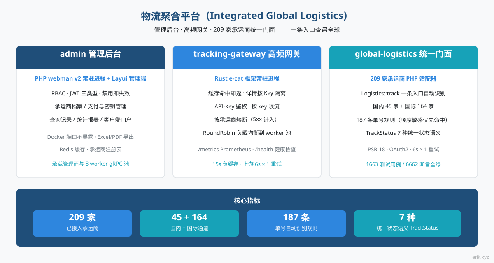
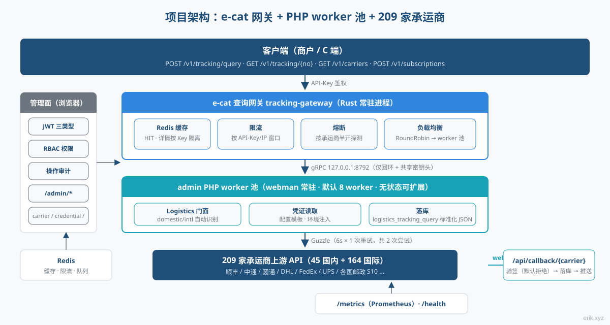
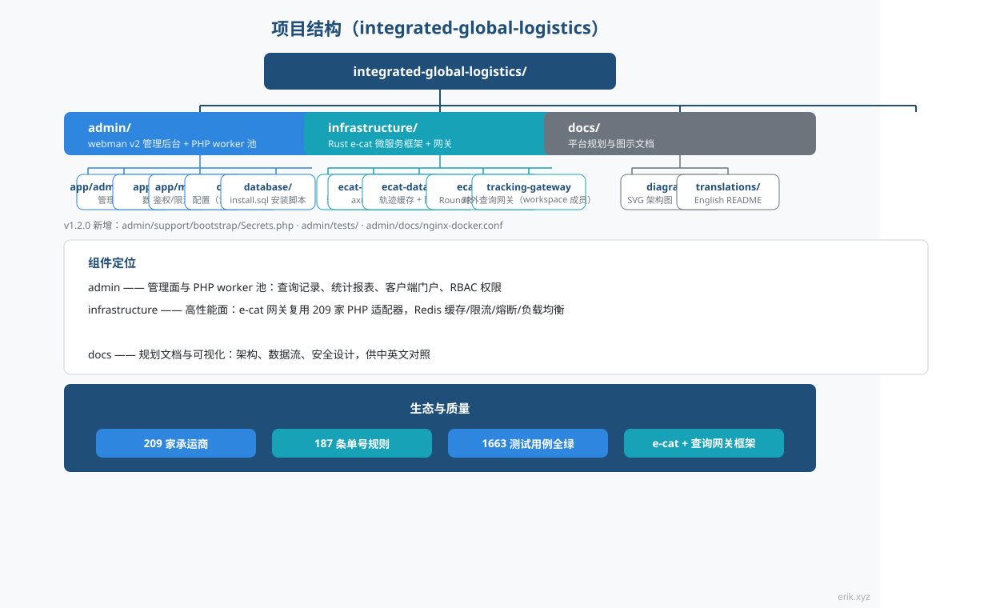
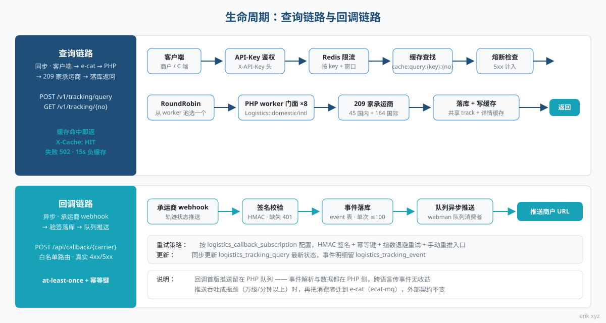
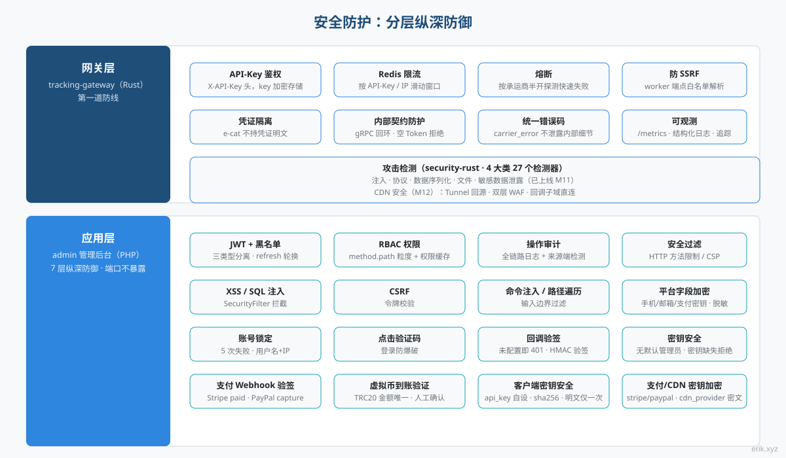

# 物流聚合平台（Integrated Global Logistics）

全球物流轨迹查询的一站式平台：**admin 管理后台**（PHP webman + Layui）承载管理面与查询 worker 池，**e-cat 高频网关**（Rust 常驻进程）扛住查询流量，**global-logistics 统一门面**（209 家承运商 PHP 适配器）一条入口查遍全球。


> 支持语言：[English / 英语](docs/translations/en/README.md)

## 项目介绍



物流聚合平台把全球 **209 家**快递 / 邮政承运商的轨迹查询统一收敛为一个平台：商户与 C 端只传入一个单号，平台自动识别国内 / 国际通道与承运商，无需关心各家协议差异（签名、OAuth2、XML/JSON、状态映射）。

平台由三个组件协作组成：

- **admin 管理后台**（PHP webman v2 + Layui）—— 管理面与 PHP worker 池：查询记录、统计报表、客户端门户，RBAC / JWT / 操作审计体系完备；
- **tracking-gateway 高频网关**（Rust e-cat 框架）—— 对外查询 API 的第一道入口：Redis 缓存、限流、按承运商熔断、worker 负载均衡，只做高频面，不懂承运商协议；
- **global-logistics 统一门面**（PHP 包）—— 209 家承运商适配器（国内 45 + 国际 164）、187 条单号自动识别规则、`TrackStatus` 7 种统一状态语义。

**当前版本**：v1.2.0（破坏性更新，升级步骤见下文）。

**当前进度**：管理面（承运商/查询记录/统计）、查询网关（对外 API 全链路）、承运商回调接收（仅落库更新轨迹）、监控统计、对外 OpenAPI 文档、客户端门户（注册/应用/套餐/订单）、支付（Stripe / PayPal / 虚拟币）、网关安全中间件、CDN 加速（Cloudflare + 缓存头）均已完成。客户端 → e-cat → worker → 承运商的轨迹查询链路可演示。

**项目宠物 E-Cat** —— 戴追踪雷达帽、手捧包裹的猫，SVG 单文件矢量，自带呼吸 / 眨眼 / 摇尾 / 雷达扫描动画并遵循 `prefers-reduced-motion` 降级。`docs/diagrams/mascot.svg` 是唯一形象源文件，已接入管理端安装向导（`/install`）、404 / 5xx 错误页、API 文档页角标与站点 favicon。

## 项目说明


- **一条入口**：`Logistics::track($trackingNo)` 自动识别国内 / 国际通道与承运商，业务层只对接一种形状；
- **自动识别**：187 条单号正则规则顺序敏感、优先命中国内通道；识别不了的场景可显式调用 `domestic()` / `international()`；
- **统一状态**：各家五花八门的原始状态映射为统一的 `TrackStatus` 枚举（待揽收 / 运输中 / 派送中 / 已签收 / 异常 / 退回 / 无法识别）；
- **全球覆盖**：DHL、FedEx、UPS、USPS 四大快递与各国邮政 S10 系统（欧洲、拉美加勒比、非洲中东、亚太四区域）；
- **对外 API**：e-cat 查询网关提供 API-Key 鉴权、Redis 缓存命中（`X-Cache: HIT`）、限流 429、按承运商熔断 503、RoundRobin worker 负载均衡；
- **查询全审计**：每次查询落库 `logistics_tracking_query`（成功/失败、耗时、错误码），管理面可查可统计；
- **客户端门户与计费**（M7-M10）：客户端注册/登录（client JWT 与 admin 隔离）、应用管理与 X-API-Key 自设、套餐/订单 API；Stripe / PayPal 双渠道 + USDT TRC20 / BEP20 / ERC20 虚拟币支付，Stripe 支付方式（Apple Pay / Google Pay / Klarna / SEPA 等）经配置即生效；
- **CDN 加速**（M12）：Cloudflare 免费版全站 HTTPS + 静态资源边缘缓存；
- **密钥零硬编码**：承运商凭证在 `config/plugin/erikwang2013/global-logistics/app.php` 模板中按承运商配置，部署时注入；JWT / 数据库加密 / 传输加密 / 内部令牌由安装器生成并写入 `.env`，代码不提供默认值；支付密钥等经 `Encryptable` 加密存储。

## 项目架构



查询链路：**客户端 → e-cat 查询网关 → PHP worker 池 → 209 家承运商**。

e-cat 网关（Rust）负责对外 API 的 API-Key 鉴权、Redis 缓存命中、限流、按承运商熔断与 RoundRobin 负载均衡；缓存命中、限流拒绝、熔断快速失败都在 e-cat 侧完成，PHP worker 只承接真实查询流量，水平扩展只需加 worker。

**e-cat 复用 209 家 PHP 适配器的分工方案**：209 个适配器是 PHP（`src/Carriers/Domestic` 45 家 + `International` 164 家），Rust 重写是数月工程且丧失上游包持续更新收益；e-cat 不需要懂承运商协议，只依赖一个稳定的内部 gRPC 契约（`InternalService` 的 `Query` / `Detect` / `Carriers`），经 `x-internal-token` 共享密钥鉴权。内部服务默认只监听 `127.0.0.1:8792`，凭证永不下发到 e-cat，安全边界清晰。

管理面（浏览器）→ `/admin/*`：JWT + RBAC 权限 + 操作审计，覆盖 tracking-query / statistics / client / client-app / plan / order。

## 项目结构



```
integrated-global-logistics/
├── admin/                          # PHP webman v2 管理后台 + worker 池
│   ├── app/
│   │   ├── admin/controller/       # 管理端控制器（carrier、tracking、统计等）
│   │   ├── api/                    # API v1（验证码 / 登录 / 刷新令牌）
│   │   ├── common/                 # Hashids / Snowflake / 加密脱敏服务
│   │   ├── middleware/             # 安全过滤 / 限流 / JWT / RBAC / 审计
│   │   ├── process/                # HTTP / 监控 / 内部 gRPC worker
│   │   └── model/                  # 数据模型（logistics_ 前缀，snowflake 主键）
│   ├── config/                     # 配置（含中文注释）
│   ├── database/
│   │   └── install.sql             # SQL 安装脚本（含权限种子数据，不含默认管理员）
│   ├── support/bootstrap/          # 启动引导（Secrets.php 校验密钥）
│   └── docs/                       # API / 架构 / 设计 / 安全文档
├── infrastructure/                 # Rust e-cat 微服务框架 + 查询网关
│   ├── ecat/                       # 聚合 crate（App 骨架）
│   ├── ecat-transport-http/        # axum HTTP 传输
│   ├── ecat-data-redis/            # 轨迹缓存 + 限流存储
│   ├── ecat-client/                # RoundRobin 负载均衡
│   └── tracking-gateway/           # 对外查询网关（workspace 新成员）
└── docs/                           # 平台规划与图示
    ├── diagrams/                   # SVG 架构图（本 README 引用）
    ├── translations/               # English README
```

## 生命周期



**查询链路（同步）**：客户端 → API-Key 鉴权 → Redis 限流（按 API-Key 哈希）→ 缓存查找（命中即返，`X-Cache: HIT`；共享运单缓存 + 按 API-Key 隔离的详情缓存，详情 TTL 7 天）→ 熔断检查（OPEN 则 503 快速失败）→ RoundRobin 选 worker → PHP worker 的 `Logistics` 门面（上游 HTTP 6s 超时 × 1 次重试，共 2 次尝试，约 12.2s，小于网关 15s 超时）→ 209 家承运商 → 落库 `logistics_tracking_query` + 写缓存 → 返回标准化 JSON。承运商 5xx / 网络失败写入 15s 负缓存，故障期间不重复转发；网关未实现 single-flight，并发穿透由负缓存兜底。

**回调链路（异步）**：承运商 webhook → `/api/callback/{carrier}` 白名单路由 + 签名校验 → 落库 `logistics_tracking_event` + 更新查询记录；未配置 `webhook_secret` 默认返回 401，仅 `CALLBACK_ALLOW_UNSIGNED=1` 的开发环境放行。

> 商户侧订阅回推已移除；如需事件通知，请从 `logistics_tracking_event` 表自行消费。

## 安全防护



分层纵深防御，要点如下：

- **网关层**（tracking-gateway）：API-Key 鉴权、Redis 限流（按 API-Key 哈希 / IP）、按承运商熔断（5xx 与传输失败计入）、防 SSRF（worker 端点白名单解析）；内部 gRPC 默认仅监听 `127.0.0.1:8792`，空 `INTERNAL_TOKEN` 时 PHP 内部接口 fail-closed、网关空 token 拒绝启动；凭证隔离 —— e-cat 不持凭证明文；
- **应用层**（admin）：JWT + 黑名单（2h access / 14d refresh，refresh 单次使用并轮换）、access / refresh / client token_type 严格区分、禁用管理员立即失效、RBAC method.path 粒度权限、操作审计全链路记录；`SecurityFilter` 拦截 XSS / SQL 注入 / CSRF / 命令注入 / 路径遍历；敏感数据 `Encryptable` 加密落库 + 脱敏导出；登录 5 次失败按用户名 + IP 锁定 15 分钟 + 点击验证码；
- **回调安全**：白名单路由 + 签名校验（sha256(secret + 去 sign 后的紧凑 JSON)，常量时间比较）；未配置 `webhook_secret` 默认 401（`CALLBACK_ALLOW_UNSIGNED=1` 仅开发）；单次事件上限 100 条、字段截断、唯一键幂等去重；错误返回真实 HTTP 4xx/5xx；
- **支付安全**（M8/M10）：Stripe / PayPal webhook 验签；Stripe 仅在 `payment_status=paid`（含 `async_payment_succeeded`）时确认，PayPal APPROVED 先 `/capture` 且只对本地存在订单扣款、`CAPTURE.COMPLETED` 才确认；manual 渠道保持 pending 由管理员确认；确认走事务 + 应用行锁，`orders.tx_id` 唯一索引拒绝重复链上交易（422）；支付密钥 `Encryptable` 加密存储于 `logistics_system_config`；
- **虚拟币到账验证**（M9）：USDT TRC20 经 Tronscan API 自动验证，金额在基础价上做 0.01–0.99 唯一化偏移，重复发起复用已展示金额；BEP20 / ERC20 人工确认；
- **客户端密钥安全**（M7）：X-API-Key 客户端自设（≥16 位），sha256 落库、明文仅创建时返回一次；client JWT（token_type=client）与 admin JWT 隔离，刷新仅接受 refresh token；
- **网关攻击检测**（M11）：`ecat-security` SecurityBodyLayer 已集成至网关（注入 / 协议 / 数据序列化 / 文件 / 敏感数据泄露攻击检测），攻击载荷在网关层即被拦截，应用层安全包继续兜底；
- **CDN 安全**（M12）：Cloudflare 免费版全站 HTTPS + 双层 WAF（边缘托管规则 + 网关应用层检测）；Tunnel 回源源站零公网暴露；回调走仅 DNS 独立子域直连防 CDN 故障丢单；限流按 X-API-Key 哈希计数不受 CDN 边缘 IP 影响；Nginx 以覆盖方式设置 `X-Forwarded-For`，防止客户端伪造来源 IP；鉴权端点一律 no-store 防数据串号；
- **统一错误语义**：限流 429、熔断 503、网关错误 400 / 401 / 404 / 502 / 500，承运商错误 `carrier_error`；异常详情只写服务端日志，不向客户端泄露内部细节。

## 功能清单


- **轨迹聚合查询**：一个单号查遍全球 —— 187 条单号规则自动识别国内 / 国际通道与承运商，209 家承运商适配器统一输出 `TrackStatus` 7 种标准状态；
- **多承运商接入**：国内 45 + 国际 164 家适配器，DHL / FedEx / UPS / USPS 与各国邮政 S10 全覆盖；承运商凭证按 `global-logistics` 配置模板注入，平台与支付密钥经 `Encryptable` 加密存储，代码不含真实密钥；
- **管理后台 RBAC**：JWT + 黑名单 + method.path 粒度权限 + 全链路操作审计，安全过滤拦截 XSS / SQL 注入 / CSRF / 命令注入；
- **支付闭环**：Stripe / PayPal 双渠道 + USDT TRC20 / BEP20 / ERC20 虚拟币，webhook 验签自动确认订单，支付方式配置即生效；
- **客户端门户与套餐**：注册 / 登录 / 应用管理 / 套餐 / 订单 API，X-API-Key 客户端自设，client JWT 与 admin 完全隔离；
- **API 网关防护**：API-Key 鉴权、Redis 限流（429）、按承运商熔断（503）、防 SSRF，攻击载荷在网关层即被拦截；
- **CDN 安全分发**：Cloudflare 免费版全站 HTTPS + 双层 WAF + 边缘缓存，Tunnel 回源源站零公网暴露；

## 一键安装

推荐使用 Docker Compose 一键部署 —— 一条命令启动 4 个服务（Nginx / PHP / MySQL / Redis），仅 Nginx 发布 80/443，MySQL / Redis 不暴露宿主端口；含健康检查与数据持久化：

```bash
bash install.sh
```

克隆仓库后按以下步骤执行：

```bash
cd integrated-global-logistics   # 进入项目根目录
bash install.sh                  # 默认对外端口 80，可用 NGINX_PORT=8080 覆盖
```

脚本自动检查 Docker 环境、启动全部服务并轮询 `/health`（最多 120 秒）；就绪后访问 `http://localhost/install` 完成安装向导（数据库初始化 + 管理员创建），Docker 环境下数据库主机填 `mysql`。

安装器会生成 JWT / 数据库加密 / 传输加密 / 内部接口随机密钥并写入 `.env`（Docker 同时同步 `.env.docker`），不预置默认管理员；安装完成后执行 `docker compose up -d --force-recreate app` 让新密钥生效。`runtime/install.lock` 请勿删除；已有管理员时安装器拒绝重装，确需重装需先备份数据库并清理数据。Docker Compose 详细部署见 [admin/README.md](admin/README.md)。

## 快速开始

**admin 管理后台**（PHP webman）：

```bash
cd admin
composer install
php start.php start
```

启动后浏览器访问安装向导完成数据库初始化和管理员创建：`http://localhost:8787/install`（默认端口 8787，可在 `config/server.php` 修改）。安装器会生成密钥并写入 `.env`，完成后执行 `php start.php restart -d` 让密钥生效；`.env` 中的 `INTERNAL_TOKEN` 需与查询网关保持一致。

**infrastructure 查询网关**（Rust e-cat）：

```bash
cd infrastructure
cargo build --offline
TRACKING_GATEWAY_CONFIG=tracking-gateway/config/config.json ./target/debug/tracking-gateway
```

网关默认监听 `0.0.0.0:8080`（`tracking-gateway/config/config.json` 可改），worker 指向 PHP 内部 gRPC 端点（默认 `http://127.0.0.1:8792`）。`internal_token` 为空时网关拒绝启动，需通过 `TRACKING_GATEWAY_INTERNAL_TOKEN` 注入与 PHP `INTERNAL_TOKEN` 相同的值；`api_keys` 中的 demo key 已移除，API-Key 由管理端审核通过后写入 Redis。PHP 内部 gRPC 默认监听 `127.0.0.1:8792`（`INTERNAL_GRPC_LISTEN` 可覆盖），worker 进程数默认 8（`INTERNAL_GRPC_WORKERS` 可覆盖）。

详细部署见 [admin/README.md](admin/README.md)（Docker Compose 编排 4 个服务：Nginx / PHP / MySQL / Redis）与实施规划文档。

## 升级到 v1.2.0（破坏性变更）

- **密钥无默认值**：`JWT_SECRET_KEY`、`ENCRYPTABLE_KEY`（32 字符）、`ENCRYPTION_KEY`（32 字符）、`INTERNAL_TOKEN` 必须显式配置。安装器会自动生成；手工部署可用 `openssl rand -hex 32` 生成 `JWT_SECRET_KEY` / `INTERNAL_TOKEN`，`ENCRYPTABLE_KEY` / `ENCRYPTION_KEY` 需 32 字符，使用 `openssl rand -hex 16`。已安装环境缺失 `JWT_SECRET_KEY` / `ENCRYPTABLE_KEY` / `ENCRYPTION_KEY` 或仍为旧公开默认值时应用拒绝启动（`APP_DEBUG=true` 仅告警）；`INTERNAL_TOKEN` 为空时内部接口 fail-closed。`.env.example` 中的旧公开默认值不可用于生产。
- **默认管理员移除**：`install.sql` 不再创建 `erik / 123456`，安装表单也不再预填 `admin888`；安装向导用预处理语句创建管理员并绑定 `super_admin`。已有环境请删除或禁用旧默认账号。
- **旧加密数据**：若历史数据使用旧公开 `ENCRYPTABLE_KEY`（`open-admin-db-encryption-key-32b`）加密，升级时设置 `ENCRYPTION_PREVIOUS_KEYS=open-admin-db-encryption-key-32b`，并尽快重加密；否则解密失败。
- **回调签名**：为每个承运商配置 `webhook_secret`；未配置时回调默认返回 401，仅开发环境可显式 `CALLBACK_ALLOW_UNSIGNED=1` 放行。
- **数据库索引**：`logistics_order.tx_id` 增加唯一索引 `uk_tx_id`，重复链上交易将返回 422；升级已有库时需先确认/补齐该索引。
- **网关令牌**：网关 `internal_token` 与 PHP `INTERNAL_TOKEN` 必须一致（网关侧用 `TRACKING_GATEWAY_INTERNAL_TOKEN` 注入）；空 token 网关拒绝启动，`demo-api-key` 已删除。
- **重启方式**：Docker 执行 `docker compose up -d --force-recreate app`；非 Docker 执行 `php start.php restart -d`。
- **安装锁**：不要删除 `runtime/install.lock`；重装需先备份数据库并清理数据。

## 文档

- [admin/docs/API.md](admin/docs/API.md) —— API 参考（统一响应格式、错误码、认证流程、限流策略、中间件链路）
- [admin/docs/ARCHITECTURE.md](admin/docs/ARCHITECTURE.md) —— 架构设计
- [admin/docs/DESIGN.md](admin/docs/DESIGN.md) —— 设计文档
- [admin/docs/SECURITY.md](admin/docs/SECURITY.md) —— 安全架构
- [admin/README.md](admin/README.md) —— 管理后台完整说明（技术栈、数据库规范、部署、CI/CD）

## English

- [English / 英语](docs/translations/en/README.md)

## 开源不易，欢迎支持

| 微信 | 支付宝 |
|:---:|:---:|
|  |  |

## 开源版 vs 商业版

本仓库是**开源版**：保留 209 家承运商轨迹查询的核心链路，适合个人学习、研究与二次开发。**商业版**由作者单独提供，在同一核心之上补齐管理面、检索、多端客户端与对外集成能力；商业授权与交付条款请联系 **erik@erik.xyz**。

### 多维度对比

数据为当前代码快照的静态清点，不含运行时压测；两版同源，商业版是开源版的超集。

| 维度 | 开源版 | 商业版 |
|---|---|---|
| **功能覆盖** | 26 控制器 / 12 模型 / 13 表 / 57 路由；轨迹查询核心闭环 | 30 / 16 / 17 / 62；增加承运商与凭据、回调订阅、CDN 服务商三个管理域 |
| **安全防护** | 9 个中间件（AdminAuth / AdminPermission / ClientAuth / RateLimit / SecurityFilter / OperationLog 等）、JWT、RBAC、入站回调 HMAC、查询审计 | 同一套中间件与安全检测器；另增承运商/CDN 凭据加密（Encryptable 5 个模型 vs 2 个）、出站订阅 HMAC/幂等/退避重试 |
| **性能与规模** | Rust `tracking-gateway` + PHP webman/Layui；Redis 缓存/限流、按承运商熔断、RoundRobin；4 个 compose 服务 | 同一 gateway；增加 Elasticsearch/Scout 索引与搜索队列，5 个 compose 服务；检索更强但资源占用更高 |
| **数据与检索** | 13 张表；MySQL LIKE | 17 张表；Elasticsearch + Scout，保留 MySQL 回退 |
| **测试与质量** | 10 个 PHPUnit 文件 / 76 用例 / 280 断言；684 个 Rust 测试；无仓库内 CI workflow | 同源测试集（随商业版快照更新）；685 个 Rust 测试；同样无 CI workflow |
| **部署与运维** | docker-compose（nginx/app/mysql/redis）、install.sh、健康检查、Prometheus 指标、apidoc | 同左 + Elasticsearch 容器；另需构建 Flutter/HarmonyOS 客户端 |
| **多端与国际化** | Layui 管理端；中文/英文文档；无对外 SDK | Layui + Flutter Web + HarmonyOS；Python/PHP/Node/Go/Rust 五语言 SDK；12 种语言文档 |
| **扩展性与二次开发** | 209 家承运商适配器、187 条单号识别规则；OpenAPI 文档；可直接改 PHP/Rust | 同左 + 管理端 CRUD、五语言 SDK、ES 检索、多端参考实现 |
| **授权与商业支持** | 个人学习/研究；商业使用需书面授权 | 商业授权、交付与支持；联系 **erik@erik.xyz** |
| **适用场景** | 个人学习、研究、二次开发、小规模自建 | 生产部署、多承运商凭据运营、企业检索、多端交付、对外 API 集成 |

### 商业版独有能力

- **承运商与凭据管理面（M1）**：`/admin/carrier`、`/admin/carrier/credential`，后台维护承运商档案与加密凭据，新增 2 张表。
- **回调订阅与异步推送（M3）**：`/admin/callback/subscription` 订阅配置、HMAC 签名、幂等键、指数退避重试与手动重推，新增 `logistics_callback_subscription` 表；开源版只保留入站回调落库。
- **CDN 服务商管理（M13）**：`/admin/cdn/provider` 管理 Cloudflare 等 CDN 服务商与加密凭据，新增 `logistics_cdn_provider` 表。
- **Elasticsearch / Scout 全文检索**：`admin/config/scout.php`、搜索队列与 `Searchable` 模型，支持比 MySQL LIKE 更完整的检索能力。
- **多端客户端**：Flutter Web 管理端（29 个 Dart 文件，PC 管理台风格）与 HarmonyOS 原生客户端（12 个 ArkTS 页面）。
- **五语言零依赖 SDK**：Python / PHP / Node.js / Go / Rust，拷贝即用，覆盖对外 API 的鉴权、查询与错误处理。
- **完整多语言文档**：除中英文外保留 11 种语言翻译；开源版已收敛为中英文。

### 两版共有

- 209 家承运商适配器（国内 45 + 国际 164）、187 条单号识别规则、`TrackStatus` 7 种统一状态。
- Rust `tracking-gateway`：API-Key 鉴权、Redis 缓存、限流、按承运商熔断、RoundRobin worker 负载均衡。
- 客户端门户（注册 / 应用 / 套餐 / 订单）、Stripe / PayPal 与 USDT 多链支付、RBAC / JWT / 操作审计、安装向导、监控统计与 OpenAPI 文档。
- 入站承运商回调接收、轨迹落库与查询审计。

**商业版授权联系：erik@erik.xyz**

**English:** The open edition keeps the core 209-carrier tracking pipeline for personal study and research. The commercial edition adds carrier/credential CRUD, callback subscriptions with async retry, CDN provider management, Elasticsearch/Scout search, a Flutter Web admin, a HarmonyOS client, five zero-dependency SDKs, and 12-language documentation. The comparison table above covers feature scope, security, performance, data/search, tests, deployment, clients/i18n, extensibility, licensing and fit. Commercial licensing and delivery terms: **erik@erik.xyz**.

## 项目授权 / Project License

Copyright (c) 2026 erik — erik@erik.xyz — https://erik.xyz

- 本项目仅供个人学习、研究使用。
- 未经作者书面授权，禁止任何形式的商业使用（包括但不限于商业部署、付费服务、二次销售、SaaS 运营及以本项目为基础提供商业服务）。
- 商业授权请联系 **erik@erik.xyz**。
- 未经授权的商业使用，作者将在全球范围内依法追究法律责任，并保留终身追责的权利。
- 第三方组件仍遵循其各自原有的许可证；视觉资产适用仓库内的 ASSETS-LICENSE.md（如适用）。

**English:** This project is provided for personal study and research only. Commercial use of any kind requires prior written authorization from the author (erik@erik.xyz). Unauthorized commercial use will be pursued for legal liability worldwide, and the author reserves the right to pursue such liability for life. Third-party components remain under their original licenses; visual assets are governed by ASSETS-LICENSE.md where applicable.

## 项目宠物表情形态 · E-Cat

| 表情 | 图片 | 代码 |
|---|---|---|
| 笑 |  | `:emoji-smile:` |
| 欢乐 |  | `:emoji-joy:` |
| 哭 |  | `:emoji-cry:` |
| 沮丧 |  | `:emoji-depressed:` |
| 惊恐 |  | `:emoji-terrified:` |
| 愤怒 |  | `:emoji-angry:` |
| 撒娇 |  | `:emoji-coquettish:` |
| 卖萌 |  | `:emoji-cute:` |
| 讨好 |  | `:emoji-pleasing:` |
| 敲打 |  | `:emoji-knocking:` |
| 捂脸 |  | `:emoji-facepalm:` |
| 吐舌头 |  | `:emoji-tongue:` |

> 12 种彩色动态形态：笑 / 欢乐 / 哭 / 沮丧 / 惊恐 / 愤怒 / 撒娇 / 卖萌 / 讨好 / 敲打 / 捂脸 / 吐舌头。每个 SVG 自带表情、情绪特效与整体动效，并遵循 `prefers-reduced-motion`。

## 视觉资产授权 / Visual Assets License

本项目的项目宠物、图片、图标、表情（包括 `docs/pet-expressions/` 等目录下的
SVG / PNG）**不是开源资产**，版权归作者所有。未经书面许可不得复制、修改、再分发或
用于商业用途；商业使用需取得商业授权，联系 **erik@erik.xyz**。详见
[ASSETS-LICENSE.md](ASSETS-LICENSE.md)。

> 代码部分仍遵循仓库原有 `LICENSE`；第三方素材（如明确标注的 Go Gopher 等）仍遵循其原许可证。
