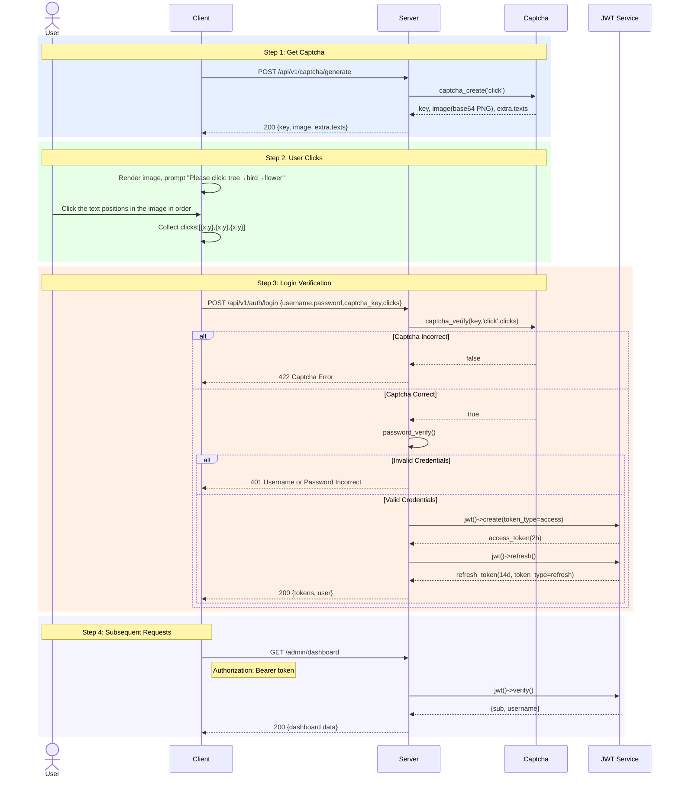

> Copyright (c) 2026 erik <erik@erik.xyz> — https://erik.xyz
>
> [中文](04-auth-captcha-flow.md) | [English](04-auth-captcha-flow.en.md)

# Authentication and Captcha Flow

Notes:

- Access, refresh and client tokens are strictly separated (`token_type`); each endpoint accepts only its own type.
- Refresh is single-use: the server claims the token with Redis `SET NX`, rotates it, and blacklists the old one. Replay returns 401.
- `AdminAuth` checks `status=1` on every request, so a disabled admin is rejected immediately.
- Login lockout is keyed by `username + IP`: 5 failures lock for 15 minutes. The rate limiter also applies separately (login 10 req/min).
