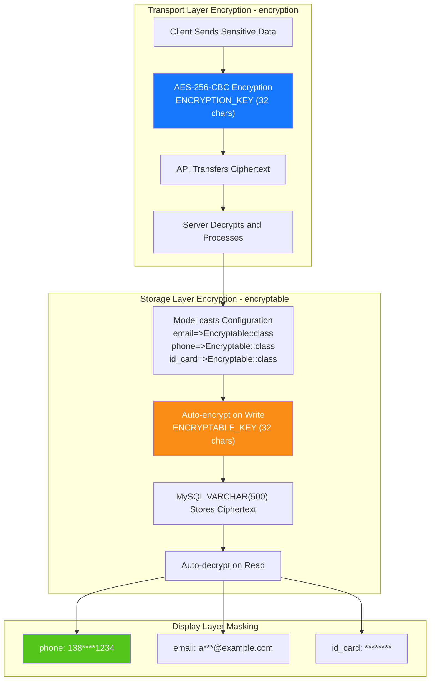

> Copyright (c) 2026 erik <erik@erik.xyz> — https://erik.xyz
>
> [中文](07-encryption-layers.md) | [English](07-encryption-layers.en.md)

# Data Encryption Layers

> Transport and storage use separate keys. Both are 32 characters, have no code default, and are generated by the installer. Data encrypted with the old public `ENCRYPTABLE_KEY` needs `ENCRYPTION_PREVIOUS_KEYS=open-admin-db-encryption-key-32b` until it has been re-encrypted with the new key.
