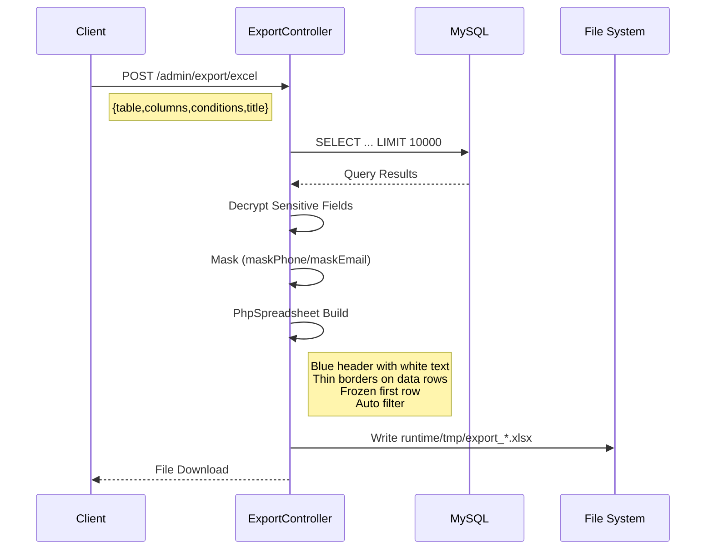
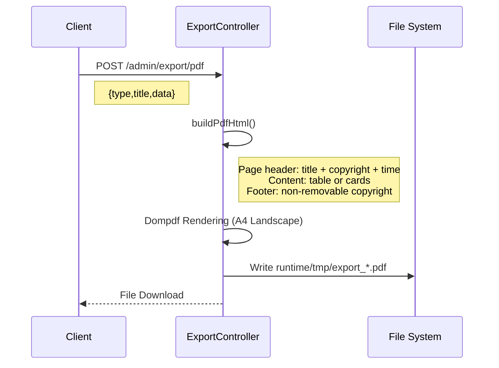

> Copyright (c) 2026 erik <erik@erik.xyz> — https://erik.xyz
>
> [中文](09-export-flow.md) | [English](09-export-flow.en.md)

# Export Business Flow

## Excel Export

## PDF Export

Notes:

- Only tables on the export whitelist can be exported; `system_config` and other security-sensitive tables are excluded.
- Sensitive columns are decrypted and masked before writing, and the PDF footer carries a non-removable copyright.
- Temporary files under `runtime/tmp/` are not automatically cleaned; schedule a cleanup job on shared or long-running hosts.
