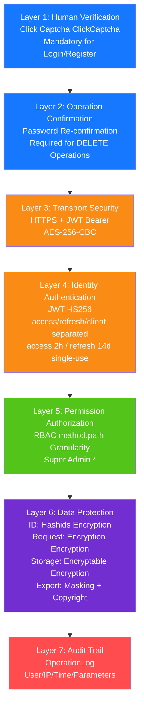

> Copyright (c) 2026 erik <erik@erik.xyz> — https://erik.xyz
>
> [中文](11-security-defense.md) | [English](11-security-defense.en.md)

# Security Defense in Depth

Additional controls not shown as separate layers:

- **Secrets**: `JWT_SECRET_KEY`, `ENCRYPTABLE_KEY`, `ENCRYPTION_KEY` and `INTERNAL_TOKEN` have no code defaults; startup validation refuses installed environments that still use public defaults.
- **Token lifecycle**: refresh is single-use (`Redis SET NX`) and rotated, old tokens are blacklisted, and disabled admins are rejected on every request.
- **Internal interface**: gRPC listens on loopback `127.0.0.1:8792` and requires `x-internal-token`; empty tokens fail closed on both PHP and gateway sides.
- **Callbacks**: missing `webhook_secret` returns 401 by default; signatures are HMAC-checked; at most 100 events per request.
- **Output**: secret config values are masked (`***` write-back ignored), `system_config` is excluded from export, and operation logs mask `/admin/config` values.
