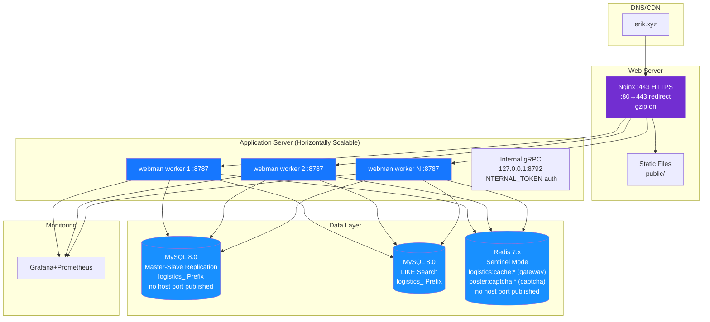

> Copyright (c) 2026 erik <erik@erik.xyz> — https://erik.xyz
>
> [中文](12-deployment.md) | [English](12-deployment.en.md)

# Deployment Topology

> In Docker Compose only Nginx publishes host ports 80/443; `app` (8787), MySQL (3306) and Redis (6379) stay on the container network. The internal gRPC listener is loopback-only and is not exposed. A stale `app` container keeps old secrets, so recreate it after installation: `docker compose up -d --force-recreate app`.
