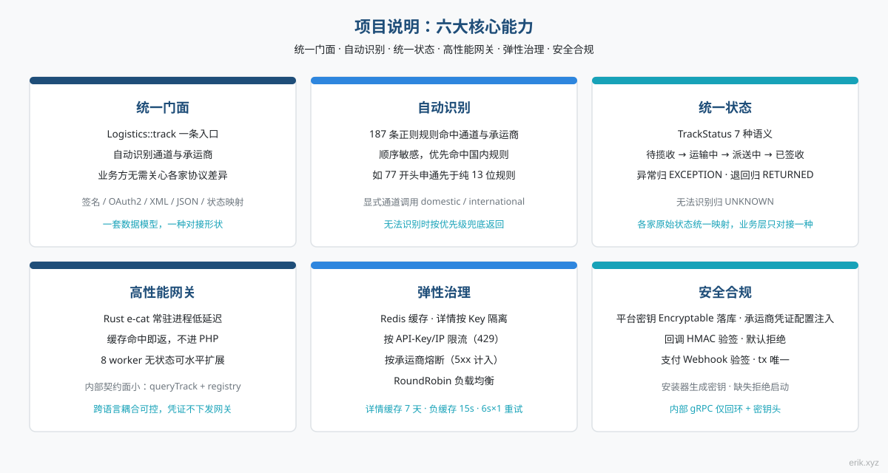

# Open Admin (open-admin)

A full-stack admin dashboard built with webman v2 + Layui.

> [中文](../../README.md) | [English](README.en.md)

## Features




| Domain | Feature | Notes |
|--------|---------|-------|
| 🔐 Auth | Login/Refresh/Logout | Click captcha + JWT + blacklist |
| | Account lockout | 5 failures → 15 min lock |
| | Concurrent session limit | Max 3 active tokens per user |
| 📊 Dashboard | Real-time stats/trends/distribution/logs | Redis cached 5 min |
| 👥 Users | CRUD + batch delete/toggle status | Soft delete + password confirmation |
| | Excel batch import | Row-level validation + error report |
| 🔒 Roles & Perms | Role CRUD + permission tree | RBAC method.path granularity |
| ⚙ Config | Key-value CRUD | Grouped management |
| 📋 Audit | Log query + source detection | 8 platforms auto-detected |
| 📁 Files | Upload/Excel export/PDF export | Sensitive data auto-masked |
| 🛡 Security | 18-layer defense-in-depth | XSS/SQLi/path traversal/cmd injection/CSRF/rate limit/CSP... |
| 🏥 Ops | Health check/metrics/API docs/security.txt | Prometheus + OpenAPI 3.0 + hg/apidoc interactive docs |
| 🔑 Client Portal | Client register/login + app management | Client JWT (`token_type=client`), API key stored as SHA-256 |
| 💳 Payments | Stripe Checkout / PayPal / USDT | Webhook confirmation, unique `tx_id`, TRC20 amount offset |
| 📦 Tracking Gateway | Rust gateway + PHP carrier adapters | h2c gRPC, Redis cache, per-carrier circuit breaker |
| 🪝 Callbacks | Carrier event push | HMAC signature, fail-closed secret, 100 events per request |
| 🌐 i18n | Chinese/English | Accept-Language header / ?lang= param |

## Copyright

```
Copyright (c) 2026 erik erik@erik.xyz — https://erik.xyz
```

This copyright notice is permanent, must not be modified, removed, or reversed. All project files are protected under this copyright.

## Tech Stack

| Layer | Technology | Notes |
|---|------|------|
| Backend | webman v2 (workerman) | High-performance PHP daemon framework |
| PHP | 8.3+ | |
| Database | MySQL 8.0+ | Table prefix `logistics_`, BIGINT non-auto-increment PKs |
| Admin UI | Layui | Static assets under `public/`, rendered by PHP controllers |

## Core Packages

| Package | Purpose |
|---|------|
| `erikwang2013/snowflake-php` | Globally unique BIGINT primary key generation |
| `erikwang2013/hashids` | API-layer ID encryption to hide real database IDs |
| `erikwang2013/jwt-webman` | JWT token issuance and verification |
| `erikwang2013/encryption` | Transport-layer sensitive data encryption |
| `erikwang2013/encryptable` | Database-layer sensitive field auto encryption |
| `erikwang2013/season` | Country flag data |
| `erikwang2013/poster-php` | Click captcha generation/verification + poster generation |
| `phpoffice/phpspreadsheet` | Excel export |
| `barryvdh/laravel-dompdf` | PDF export (Dompdf-based) |

## Project Structure

```
open-admin/
├── app/
│   ├── admin/controller/       # Admin controllers
│   │   ├── DashboardController.php # Dashboard (Redis cached)
│   │   ├── UserController.php      # User CRUD + batch ops
│   │   ├── RoleController.php      # Role CRUD
│   │   ├── PermissionController.php# Permission CRUD
│   │   ├── ConfigController.php    # System config CRUD
│   │   ├── LogController.php       # Operation log viewer
│   │   ├── ProfileController.php   # Profile + logout
│   │   ├── ExportController.php    # Excel/PDF export
│   │   ├── ImportController.php    # Excel import users
│   │   ├── UploadController.php    # File upload
│   │   ├── HealthController.php    # Health check
│   │   └── DocsController.php      # OpenAPI docs
│   ├── api/
│   │   └── v1/controller/          # API v1 (version in URL path)
│   │       ├── CaptchaController.php
│   │       ├── AuthController.php    # Admin login/refresh
│   │       ├── ClientAuthController.php # Client register/login
│   │       └── ClientAppController.php  # Client app management
│   ├── middleware/             # Middleware
│   │   ├── Cors.php            # CORS
│   │   ├── SecurityFilter.php  # Attack detection (HTTP method restriction/XSS/SQLi/path traversal/cmd injection/CSRF)
│   │   ├── RateLimit.php       # Redis rate limiting
│   │   ├── AdminAuth.php       # JWT auth + blacklist
│   │   ├── AdminPermission.php # RBAC authorization
│   │   └── OperationLog.php    # Auto operation logging (with source detection)
│   ├── model/                  # Eloquent models
│   └── process/                # Processes (Http, Monitor, InternalGrpcWorker)
├── support/bootstrap/Secrets.php # Startup secret validation
├── config/                     # Config files
├── database/install.sql        # SQL install script (incl. permission seeds, no default admin)
└── vendor/                     # Composer dependencies
```

## Requirements

- PHP >= 8.3
- Composer 2.x
- MySQL >= 8.0

## Quick Start

### 1. Install Dependencies

```bash
composer install
```

### 2. Configure Environment

```bash
cp .env.example .env
```

Security keys are required (the installer generates them into `.env`; for manual deployments use `openssl rand -hex 32` for JWT and `openssl rand -hex 16` for the 32-character encryption keys):

| Variable | Description | Default |
|---------|-------------|---------|
| `JWT_SECRET_KEY` | JWT signing key | none, required |
| `ENCRYPTABLE_KEY` | Database field encryption key (32 chars) | none, required |
| `ENCRYPTION_KEY` | API transport encryption key (32 chars) | none, required |
| `INTERNAL_TOKEN` | Gateway → PHP worker shared secret | none, required for gRPC |
| `SNOWFLAKE_DATACENTER_ID` | Datacenter ID (0-31) | derived from process PID |
| `SNOWFLAKE_WORKER_ID` | Worker ID (0-31) | derived from process PID |

An installed environment refuses to start when `JWT_SECRET_KEY`, `ENCRYPTABLE_KEY` or `ENCRYPTION_KEY` is missing (`APP_DEBUG=true` only logs a warning). An empty `INTERNAL_TOKEN` makes the internal gRPC service reject every request, and the gateway refuses to start. The old public defaults in `.env.example` must not be used in production.

### 3. One-Click Install

Start the server, then open the install wizard in your browser to set up the database and create an admin account:

```bash
php start.php start
```

Default: `http://0.0.0.0:8787` (change port in `config/server.php`).

Open **`http://localhost:8787/install`** and follow the wizard:

| Step | Description |
|------|-------------|
| ① Database | Host, port, database name, username, password |
| ② Admin Account | Admin username and password (you choose them; no default account) |

Click "Start Install" — tables are created, permissions seeded, admin account created, `.env` is updated, and random JWT/encryption/internal-token secrets are generated.

> After installation, `runtime/install.lock` is created to prevent re-installation. Do not delete it; the installer refuses to run while an admin account exists. If you really need to reinstall, back up the database and clean the data first.

### 4. Login

Visit `http://localhost:8787` and log in with the admin credentials set during installation.

### 6. Docker Compose (Recommended for Production)

Full Docker orchestration with 4 services: Nginx, PHP (webman app), MySQL, Redis.

```bash
# 1. Start all services (app reads .env.docker)
docker compose up -d

# 2. Open the install wizard in your browser
# http://localhost/install  (database host: mysql)

# 3. Recreate app so the generated secrets take effect
docker compose up -d --force-recreate app

# 4. Access
# http://localhost  (Nginx reverse proxy -> app:8787)
```

- `Dockerfile`: PHP 8.3 + OPcache + Composer, based on `php:8.3-cli`
- `docker-compose.yml`: 4 services, isolated network, persistent volumes; only Nginx publishes host ports 80/443, while app (8787), MySQL (3306) and Redis (6379) stay on the container network
- `.env.docker`: Docker-specific environment variables; the installer generates the required secrets into `.env` and syncs them into `.env.docker`
- `docs/nginx-docker.conf`: site config that proxies `app:8787` and overwrites `X-Forwarded-For`
- After installation, `install.sh` polls `/health` (MySQL/Redis may still be starting; the installer prints the DB host hint and the force-recreate step)

## Database Conventions

- **Prefix**: `logistics_`
- **Primary Key**: `id BIGINT UNSIGNED NOT NULL`, **NO AUTO_INCREMENT**
- **ID Generation**: PKs are generated at the application layer via `SnowflakeService::generate()`
- **Required Columns**: Every table must have `id`, `created_at`, `updated_at`
- **Soft Delete**: Add `deleted_at DATETIME DEFAULT NULL` where needed
- **Sensitive Fields**: Phone, email, ID card — stored as ciphertext via the `encryptable` plugin, database column type `VARCHAR(500)`

## API Documentation

The complete API reference (response format, error codes, all endpoint details, auth flow, rate limiting, middleware chain) lives in **[docs/API.en.md](../API.en.md)**. Highlights:

- **Response format**: `{ "code": 0, "message": "success", "data": {...} }`, `code=0` means success
- **Error codes**: `400` bad request / `401` unauthenticated / `403` forbidden / `404` not found / `422` validation failed / `429` rate limited / `500` server error
- **Authentication**: `Authorization: Bearer <token>`; access_token TTL 2h, refresh_token TTL 14d
- **ID handling**: IDs in requests/responses are hashid-encrypted strings, real database IDs are never exposed

## Frontend Notes

### Admin UI (Layui)

- Admin pages and static assets live under `public/`, using bundled Layui components.
- Login, dashboard, users, roles, config, logs, and profile pages are rendered directly by PHP controllers.

## Development Rules

- No leading `\` on global function/class references — use `use` imports
- All PHP files must include the copyright header
- All config files must include inline comments
- Primary keys must be generated at the application layer via snowflake — no auto-increment
- All IDs in API parameters and responses must be encoded/decoded via hashids
- AdminPermission middleware uses Redis cache for user permissions (TTL=60s), eliminating N+1 query bottlenecks

## Deployment

### Docker Compose (Recommended)

`docker-compose.yml` in the project root orchestrates 4 services:

| Service | Image | Host Port |
|------|------|------|
| `nginx` | nginx:alpine | 80, 443 |
| `app` | Local `Dockerfile` build | not published (internal 8787) |
| `mysql` | mysql:8.0 | not published (internal 3306) |
| `redis` | redis:7-alpine | not published (internal 6379) |

The PHP image is built from `Dockerfile`, based on `php:8.3-cli` with OPcache enabled. Only Nginx publishes host ports; the app, MySQL and Redis are reachable only on the Compose network, which also means the database host must be `mysql` inside Docker.

```bash
docker compose up -d
# after /install:
docker compose up -d --force-recreate app
# non-Docker deployment:
php start.php restart -d
```

### CI/CD

GitHub Actions CI pipeline: `.github/workflows/ci.yml`

- PHP syntax check (`php -l`)
- PHPUnit tests

### Database Backup

`database/backup/` directory:

- `backup.sh` — mysqldump + gzip backup, auto-clears backups older than 30 days
- `restore.sh` — interactive restore, lists available backups for selection

### Nginx Security

See `docs/nginx-security.conf` for bare-metal reverse-proxy hardening, and `docs/nginx-docker.conf` for the Docker deployment (proxies `app:8787`, overwrites `X-Forwarded-For` with `$remote_addr`). The bare-metal reference appends to `X-Forwarded-For`; ensure the outermost proxy overwrites it so clients cannot spoof the IP used for rate limiting.

### Internal gRPC

The PHP worker exposes `InternalService.Query/Detect/Carriers` on `tcp://127.0.0.1:8792` (8 workers) with `x-internal-token`. Set the same `INTERNAL_TOKEN` on PHP and the Rust tracking gateway; an empty token fails closed. See [ARCHITECTURE.en.md](../ARCHITECTURE.en.md#13-tracking-gateway-and-internal-grpc).

## Upgrade to v1.2.0 (Breaking Changes)

v1.2.0 is a security-hardening release with breaking changes. Before upgrading, back up the database and `.env`.

1. **No default admin account.** The installer no longer seeds `erik/123456` or prefills `admin888`; it uses prepared statements and binds the first account to `super_admin`. It refuses to run while an admin exists and keeps `runtime/install.lock`. Back up the database before any deliberate reinstall.
2. **Required secrets.** `JWT_SECRET_KEY`, `ENCRYPTABLE_KEY` (32 chars), `ENCRYPTION_KEY` (32 chars) and `INTERNAL_TOKEN` have no code defaults. The installer generates them into `.env` and syncs `.env.docker`; an installed environment refuses to start if one of the three encryption/JWT keys is missing or still an old public default (`APP_DEBUG=true` only warns), and an empty `INTERNAL_TOKEN` makes the internal gRPC service reject every request.
3. **Existing encrypted data.** Data encrypted with the old public `ENCRYPTABLE_KEY` cannot be decrypted after upgrading. Set `ENCRYPTION_PREVIOUS_KEYS=open-admin-db-encryption-key-32b`, start the service, then re-encrypt the data with the new key and remove the legacy key.
4. **Token types.** Access, refresh and client tokens are strictly separated. Refresh tokens are single-use and rotated; clients must call `/api/v1/auth/refresh` with a refresh token instead of reusing an access token or an old refresh token. Disabled admins lose access immediately, and `AdminPermission` returns 401 instead of allowing a missing `adminId`.
5. **Internal gRPC.** PHP listens on `127.0.0.1:8792` (8 workers). PHP and the gateway must use the same `INTERNAL_TOKEN`; an empty token is rejected (fail closed). The old `demo-api-key` is removed and gateway error codes no longer use 5001.
6. **Docker.** Only Nginx publishes host ports; MySQL/Redis are internal and the DB host is `mysql`. After installation run `docker compose up -d --force-recreate app`; non-Docker deployments run `php start.php restart -d`, otherwise old processes keep empty or stale keys.
7. **Gateway semantics.** Error mapping uses 400/401/404/502/500 (plus 429 for rate limiting and 503 when a breaker is open); carrier 5xx responses and transport errors count toward the circuit breaker; detail cache is scoped by API-key hash (7-day TTL); a shared tracking-cache hit backfills the current key's detail cache; carrier HTTP timeout is 6s with 1 retry.
8. **Webhooks and callbacks.** Carrier callbacks return 401 when `webhook_secret` is missing (`CALLBACK_ALLOW_UNSIGNED=1` is development-only), handle at most 100 events per request, and return real HTTP 4xx/5xx statuses. Stripe requires `payment_status=paid`; PayPal confirms only on `CAPTURE.COMPLETED`; manual orders stay pending until admin confirmation; `orders.tx_id` is unique and duplicates return 422.
9. **Config and errors.** Secret config values are masked, `***` write-back is ignored, `system_config` is not exportable, and operation logs mask `/admin/config` values. API responses return generic errors while upstream details stay in server logs.

## Open Source Needs Your Support

| WeChat | Alipay |
|:---:|:---:|
|  |  |

## 项目授权 / Project License

Copyright (c) 2026 erik erik@erik.xyz — https://erik.xyz

- 本项目仅供个人学习、研究使用。
- 未经作者书面授权，禁止任何形式的商业使用（包括但不限于商业部署、付费服务、二次销售、SaaS 运营及以本项目为基础提供商业服务）。
- 商业授权请联系 **erik@erik.xyz**。
- 未经授权的商业使用，作者将在全球范围内依法追究法律责任，并保留终身追责的权利。
- 第三方组件仍遵循其各自原有的许可证；视觉资产适用仓库内的 ASSETS-LICENSE.md（如适用）。

**English:** This project is provided for personal study and research only. Commercial use of any kind requires prior written authorization from the author (erik@erik.xyz). Unauthorized commercial use will be pursued for legal liability worldwide, and the author reserves the right to pursue such liability for life. Third-party components remain under their original licenses; visual assets are governed by ASSETS-LICENSE.md where applicable.
