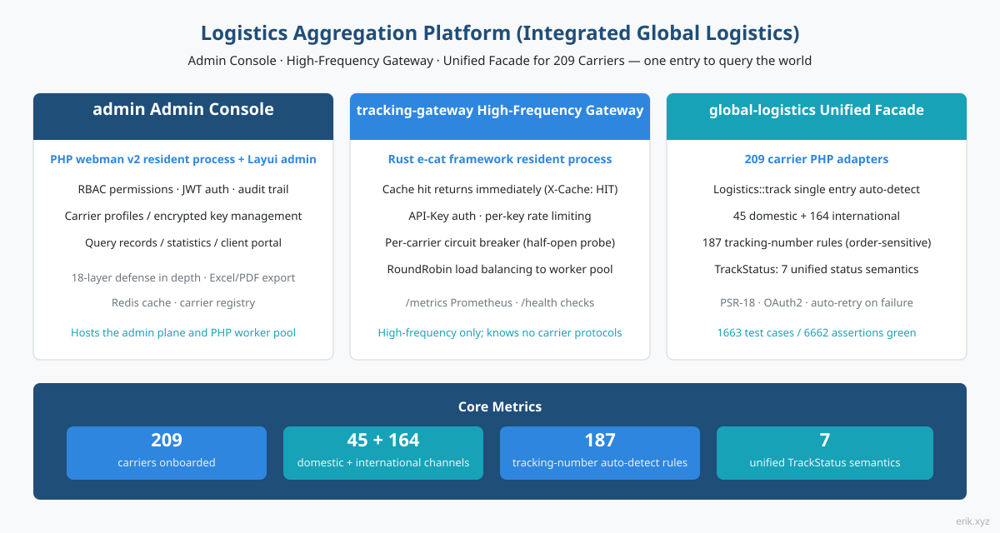
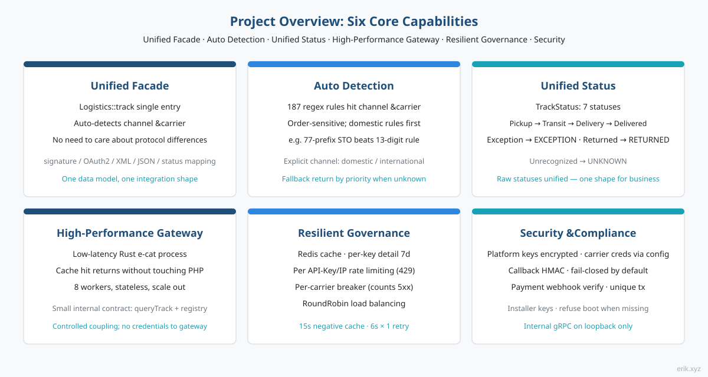
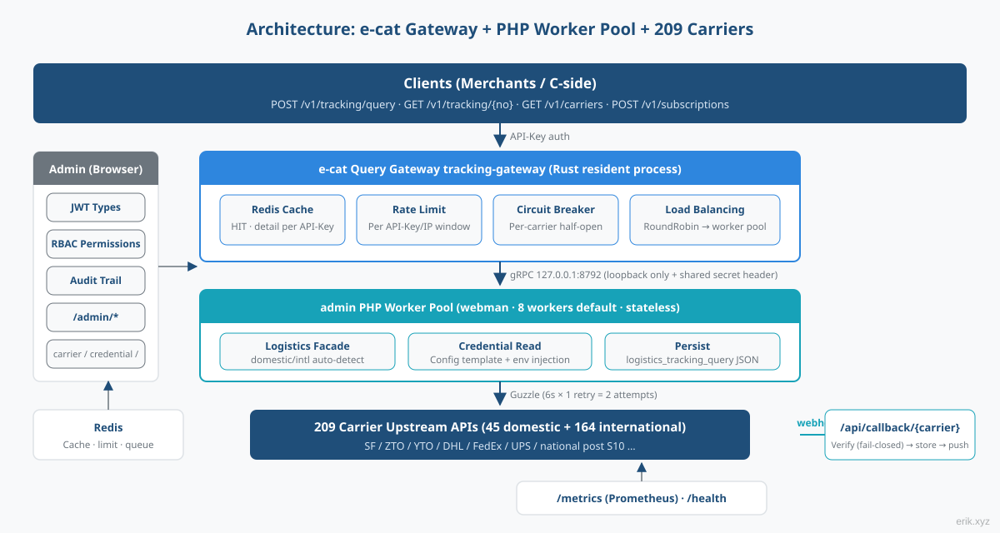
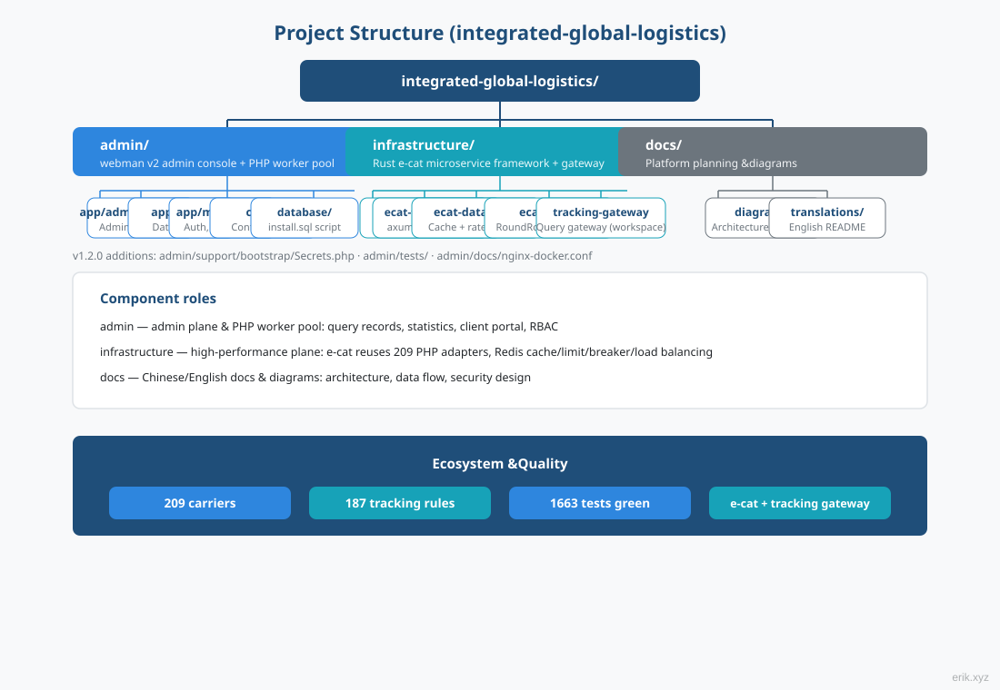
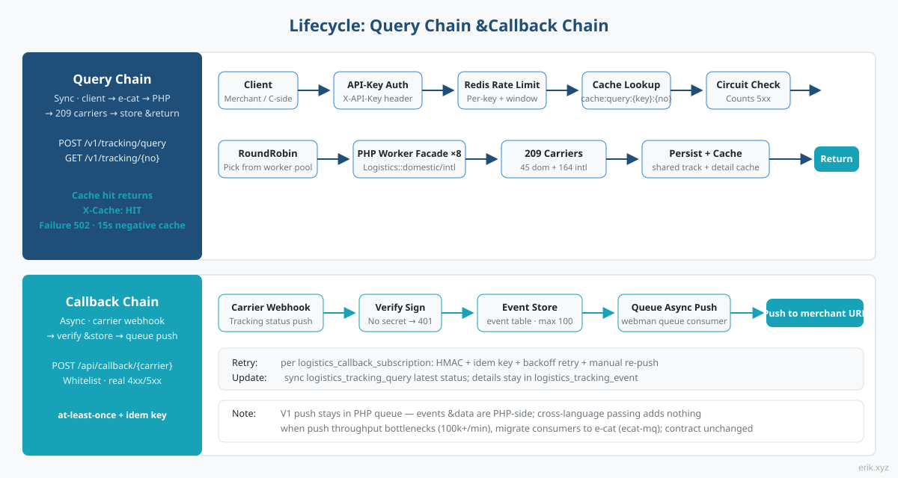
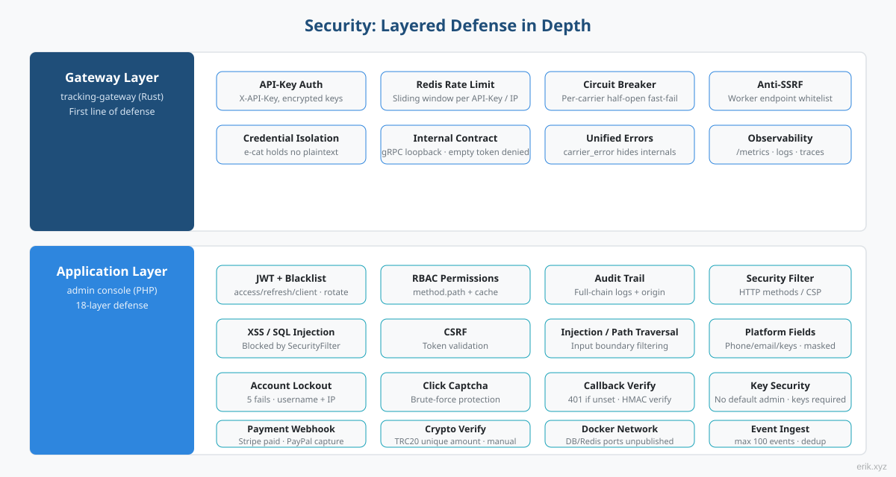

# Logistics Aggregation Platform (Integrated Global Logistics)


One-stop platform for global logistics tracking: the **admin management console** (PHP webman + Layui) hosts the management plane and the query worker pool, the **e-cat high-frequency gateway** (long-running Rust process) carries the query traffic, and the **global-logistics unified facade** (PHP adapters for 209 carriers) lets you query the whole world through a single entry.

> Languages: [English](README.md) · [中文](../../../README.md)

## Project Introduction



The logistics aggregation platform unifies tracking queries from **209** courier / postal carriers worldwide into one platform: merchants and C-side clients pass in only a tracking number, and the platform automatically identifies the domestic / international channel and the carrier — no need to care about each carrier's protocol differences (signature, OAuth2, XML/JSON, status mapping).

The platform is composed of three components working together:

- **admin management console** (PHP webman v2 + Layui) — management plane and PHP worker pool: query records, statistics reports, client portal, complete RBAC / JWT / operation audit system;
- **tracking-gateway high-frequency gateway** (Rust e-cat framework) — the first entry of the external query API: Redis cache, rate limiting, per-carrier circuit breaking, worker load balancing; it only handles the high-frequency plane and knows nothing about carrier protocols;
- **global-logistics unified facade** (PHP package) — adapters for 209 carriers (45 domestic + 164 international), 187 tracking-number auto-detection rules, 7 unified status semantics of `TrackStatus`.

**Current progress**: the admin plane (carrier / query records / statistics), query gateway (full external API chain), inbound carrier callback ingestion, monitoring & statistics, external OpenAPI docs, client portal (register / app / plan / order), payments (Stripe / PayPal / crypto), gateway security middleware, and CDN acceleration (Cloudflare + cache headers) are complete. The client → e-cat → worker → carrier tracking query chain is demonstrable.

**Project pet E-Cat** — a cat wearing a tracking-radar cap and holding a parcel. A single self-contained SVG vector with breathing / blinking / tail-wagging / radar-sweep animations, with `prefers-reduced-motion` fallback. `docs/diagrams/mascot.svg` is the single source of the character; it is wired into the admin install wizard (`/install`), the 404 / 5xx error pages, the API docs corner badge, and the site favicon.

## Project Description



- **One entry**: `Logistics::track($trackingNo)` automatically identifies the domestic / international channel and carrier; the business layer only deals with one shape;
- **Auto detection**: 187 tracking-number regex rules are order-sensitive and prioritize domestic channels; for unrecognized scenarios, `domestic()` / `international()` can be called explicitly;
- **Unified status**: each carrier's varied raw statuses are mapped to a unified `TrackStatus` enum (pending pickup / in transit / out for delivery / delivered / exception / returned / unrecognized);
- **Global coverage**: the four major couriers DHL, FedEx, UPS, USPS and the national postal S10 systems of various countries (Europe, Latin America & Caribbean, Africa & Middle East, Asia-Pacific);
- **External API**: the e-cat query gateway provides API-Key authentication, Redis cache hits (`X-Cache: HIT`), rate limiting 429, per-carrier circuit breaking 503, RoundRobin worker load balancing;
- **Client portal & billing** (M7–M10): client register / login (client JWT isolated from admin), app management with self-set X-API-Key, plan / order API; Stripe / PayPal plus USDT TRC20 / BEP20 / ERC20 crypto payments, Stripe payment methods (Apple Pay / Google Pay / Klarna / SEPA etc.) configurable at runtime;
- **CDN acceleration** (M12): Cloudflare free plan full-site HTTPS + edge caching for static assets;
- **Zero hard-coded keys**: all keys are injected via configuration, and the database layer stores them as Encryptable ciphertext — code and keys are fully separated.

## Project Architecture



Query chain: **client → e-cat query gateway → PHP worker pool → 209 carriers**.

The e-cat gateway (Rust) handles API-Key authentication, Redis cache hits, rate limiting, per-carrier circuit breaking and RoundRobin load balancing for the external API; cache hits, rate-limit rejections and circuit-breaker fast-fails all happen on the e-cat side, and PHP workers only carry real query traffic — horizontal scaling is just adding workers.

**The plan of e-cat reusing 209 PHP adapters**: the 209 adapters are PHP (`src/Carriers/Domestic` 45 + `International` 164); rewriting them in Rust would be months of work and would lose the benefit of continuous upstream package updates. e-cat does not need to understand carrier protocols — it depends only on a stable internal contract (`/internal/tracking/query` + `/internal/carriers` registry sync). Credentials are never delivered to e-cat, keeping a clear security boundary.

Management plane (browser) → `/admin/*`: JWT + RBAC permissions + operation audit, covering carrier / carrier-credential / tracking-query / callback-subscription / statistics / client / client-app / plan / order / cdn-provider.

## Project Structure



```
integrated-global-logistics/
├── admin/                          # PHP webman v2 管理后台 + worker 池
│   ├── app/
│   │   ├── admin/controller/       # 管理端控制器（carrier、tracking、统计等）
│   │   ├── api/                    # API v1（验证码 / 登录 / 刷新令牌）
│   │   ├── common/                 # Hashids / Snowflake / 加密脱敏服务
│   │   ├── middleware/             # 安全过滤 / 限流 / JWT / RBAC / 审计
│   │   └── model/                  # 数据模型（logistics_ 前缀，snowflake 主键）
│   ├── config/                     # 配置（含中文注释）
│   ├── database/
│   │   └── install.sql             # SQL 安装脚本（含权限种子数据）
│   └── docs/                       # API / 架构 / 设计 / 安全文档
├── infrastructure/                 # Rust e-cat 微服务框架 + 查询网关
│   ├── ecat/                       # 聚合 crate（App 骨架）
│   ├── ecat-transport-http/        # axum HTTP 传输
│   ├── ecat-data-redis/            # 轨迹缓存 + 限流存储
│   ├── ecat-client/                # RoundRobin 负载均衡
│   └── tracking-gateway/           # 对外查询网关（workspace 新成员）
└── docs/                           # 平台规划与图示
    ├── diagrams/                   # SVG 架构图（本 README 引用）
    ├── translations/               # English README
```

## Lifecycle



**Query chain (synchronous)**: client → API-Key auth → Redis rate limiting → cache lookup (return on hit, `X-Cache: HIT`) → circuit-breaker check (503 fast-fail on OPEN) → RoundRobin worker selection → the `Logistics` facade in the PHP worker (the in-package RetryingClient has 2 built-in retries) → 209 carriers → persist to `logistics_tracking_query` + write cache → return standardized JSON.

**Callback chain (asynchronous)**: carrier webhook → `/api/callback/{carrier}` whitelist route + signature verification → persist to `logistics_tracking_event` + update the query record. Outbound merchant push has been removed; consume `logistics_tracking_event` directly if event notification is needed.


## Security



Layered defense in depth, key points:

- **Gateway layer** (tracking-gateway): API-Key authentication, Redis rate limiting (by key / IP), per-carrier circuit breaking, SSRF protection (whitelist resolution of worker endpoints); `/internal` listens only on the internal network + shared secret header; credential isolation — e-cat holds no plaintext credentials;
- **Application layer** (admin): JWT + blacklist (2h access / 14d refresh), RBAC method.path-granularity permissions, full-chain operation audit; `SecurityFilter` blocks XSS / SQL injection / CSRF / command injection / path traversal; sensitive data stored encrypted with `Encryptable` + masked export; login locked for 15 minutes after 5 failures + click captcha;
- **Callback security**: whitelist route + HMAC signature verification, at-least-once delivery + idempotency key to prevent duplicate pushes;
- **Unified error semantics**: rate limit 429, circuit break 503, carrier error `carrier_error` — no internal details leaked to clients.
- **Payment security** (M8/M10): Stripe / PayPal webhook verification (HMAC-SHA256 / verify-webhook-signature), auto order confirmation + manual admin fallback; payment keys stored encrypted via `Encryptable` in `logistics_system_config`;
- **Crypto payment verification** (M9): USDT TRC20 auto-verified via the Tronscan API; BEP20 / ERC20 confirmed manually;
- **Client key security** (M7): X-API-Key is client-set (≥16 chars), stored as sha256 — plaintext returned only once at creation; client JWTs (token_type=client) isolated from admin JWTs;
- **Gateway attack detection** (M11): `ecat-security` SecurityBodyLayer integrated into the gateway (injection / protocol / data serialization / file / sensitive-data leak detectors); attack payloads are blocked at the gateway layer, with the application-layer security package as backstop;
- **CDN security** (M12): Cloudflare free plan full-site HTTPS + dual-layer WAF (edge managed rules + gateway application-layer detection); Tunnel origin keeps the source zero-exposed; callbacks go through DNS-only subdomain direct connection to avoid order loss on CDN outage; rate limiting counts by X-API-Key, unaffected by CDN edge IPs; authenticated endpoints are always no-store to prevent cross-user cache mixing;

## Features


- **Aggregated tracking queries: one tracking number across the globe — 187 number-pattern rules auto-detect the domestic/international channel and carrier, 209 carrier adapters unify output into 7 standard `TrackStatus` states;**
- **Multi-carrier integration: 45 domestic + 164 international adapters, full coverage of DHL / FedEx / UPS / USPS and national posts S10, credentials encrypted at rest, zero hardcoded keys;**
- **Admin RBAC: JWT + blacklist + method.path granular permissions + full audit trail, security filter blocks XSS / SQL injection / CSRF / command injection;**
- **Payment closed loop: Stripe / PayPal plus USDT TRC20 / BEP20 / ERC20, webhook signature verification auto-confirms orders, payment methods take effect via config;**
- **Client portal & plans: register / login / app management / plans / orders API, self-set X-API-Key, client JWT fully isolated from admin;**
- **API gateway protection: API-Key auth, Redis rate limiting (429), per-carrier circuit breaker (503), SSRF protection, attack payloads blocked at the gateway layer;**
- **CDN secure delivery: Cloudflare free plan full-site HTTPS + dual WAF + edge cache, Tunnel origin with zero public exposure;**

## One-Click Install

Recommended: one-command Docker Compose deployment — starts 4 services (Nginx / PHP / MySQL / Redis) with health checks and data persistence:

```bash
bash install.sh
```

After cloning the repository:

```bash
cd integrated-global-logistics   # enter project root
bash install.sh                  # port 80 by default, override with NGINX_PORT=8080
```

The script checks the Docker environment, starts all services and polls health checks (up to 120 seconds); once ready, visit `http://localhost/install` to complete the installation wizard (database initialization + admin creation). See [admin/README.md](../../../admin/README.md) for the detailed Docker Compose deployment.

## Quick Start

**admin management console** (PHP webman):

```bash
cd admin
composer install
php start.php start
```

After startup, open the installation wizard in your browser to complete database initialization and admin creation: `http://localhost:8787/install` (default port 8787, changeable in `config/server.php`).

**infrastructure query gateway** (Rust e-cat):

```bash
cd infrastructure
cargo build
```

For detailed deployment, see [admin/README.md](../../../admin/README.md) (Docker Compose orchestrates 4 services: Nginx / PHP / MySQL / Redis) and the implementation plan document.

## Documentation

- [admin/docs/API.md](../../../admin/docs/API.md) — API reference (unified response format, error codes, authentication flow, rate-limit policies, middleware chain)
- [admin/docs/ARCHITECTURE.md](../../../admin/docs/ARCHITECTURE.md) — architecture design
- [admin/docs/DESIGN.md](../../../admin/docs/DESIGN.md) — design document
- [admin/docs/SECURITY.md](../../../admin/docs/SECURITY.md) — security architecture
- [admin/README.md](../../../admin/README.md) — full admin console documentation (tech stack, database conventions, deployment, CI/CD)

## Translations

- [English](README.md)
- [中文](../../../README.md)

## Open Source Is Not Easy — Support Welcome

| WeChat | Alipay |
|:---:|:---:|
|  |  |

## 项目授权 / Project License

Copyright (c) 2026 erik <erik@erik.xyz> — https://erik.xyz

- 本项目仅供个人学习、研究使用。
- 未经作者书面授权，禁止任何形式的商业使用（包括但不限于商业部署、付费服务、二次销售、SaaS 运营及以本项目为基础提供商业服务）。
- 商业授权请联系 **erik@erik.xyz**。
- 未经授权的商业使用，作者将在全球范围内依法追究法律责任，并保留终身追责的权利。
- 第三方组件仍遵循其各自原有的许可证；视觉资产适用仓库内的 ASSETS-LICENSE.md（如适用）。

**English:** This project is provided for personal study and research only. Commercial use of any kind requires prior written authorization from the author (erik@erik.xyz). Unauthorized commercial use will be pursued for legal liability worldwide, and the author reserves the right to pursue such liability for life. Third-party components remain under their original licenses; visual assets are governed by ASSETS-LICENSE.md where applicable.
